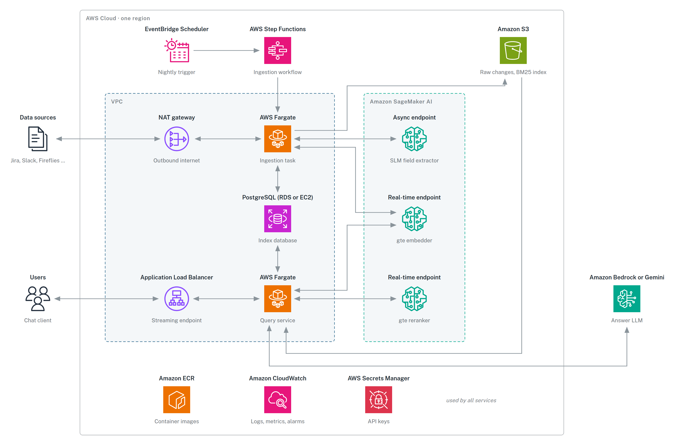

# Running the pipeline on AWS

> [!note] Status
> Draft. A section of the main article, after the pipeline is built and evaluated.
> Architecture and one load test; prices come in the next round. Working notes with every
> detail: `docs/architecture/001_aws_architecture.md`.

In the sections above, everything ran on my machine and on rented GPUs: Postgres in Docker,
the models in Python, an evaluation script calling Gemini. This section moves the same pipeline
to AWS as a service: what goes where, why, and what one load test says about its size.

The service has two parts that share one database. A nightly job pulls only what changed in the
nine sources (Jira, Slack, Gmail, Fireflies and the rest), runs the SLM and the embedder on the
new documents, writes them to Postgres and stops. An always-on query service takes questions,
runs the pipeline and streams the answer back.

## The diagram

The architecture has two pipelines that share one database.

**The ingestion pipeline** runs once a day, or on any other schedule. EventBridge Scheduler
starts a Step Functions workflow, which runs the ingestion task on Fargate. The task asks the
data sources for what changed since the last run, sends the new documents to the SLM and the
embedder on SageMaker, writes the results to Postgres, and puts the raw changes and a fresh
BM25 index in S3. Then it stops, so it costs nothing between runs.

**The inference pipeline** runs all the time. A question comes in through the load balancer to
the query service on Fargate. The query service searches with BM25 and in Postgres, calls the
embedder and the reranker on SageMaker, asks the LLM for the answer and streams it back.

Postgres links the two: ingestion writes to it, inference reads from it. The calls to the data
sources and to Gemini leave AWS through the NAT gateway. ECR, CloudWatch and Secrets Manager
serve both pipelines.

### All services

| Part | Service | Role | What it does |
|---|---|---|---|
| Ingestion | Amazon EventBridge Scheduler | Nightly trigger | Starts the ingestion workflow at 02:00. Weekly is the same rule with another cron expression. |
| Ingestion | AWS Step Functions | Ingestion workflow | Runs the ingestion task, retries or alerts on failure, then restarts the query service so it loads the new BM25 index. |
| Ingestion | AWS Fargate | Ingestion task | One CPU container: fetches what changed, sends new documents to the SLM and gte endpoints, writes Postgres, rebuilds BM25 into S3, moves the watermarks and stops. |
| Ingestion | NAT gateway | Outbound internet | Lets the tasks in the private network reach the source APIs, and Gemini if it stays the LLM. |
| Ingestion | Data sources (outside AWS) | Jira, Slack, Fireflies … | The nine company tools the documents come from, read through their APIs. |
| Models | Amazon SageMaker async endpoint | SLM field extractor | Qwen3.5-2B with the merged LoRA on a GPU. Scales to zero between runs; requests queue while it wakes up. |
| Models | Amazon SageMaker real-time endpoint | gte embedder | The fine-tuned gte on a GPU. Query vectors for every question, document vectors for ingestion. Always on. |
| Models | Amazon SageMaker real-time endpoint | gte reranker | Scores ~100 documents per question on a GPU. Always on. |
| Storage | PostgreSQL (Amazon RDS or EC2) | Index database | Documents, vectors, extracted fields, watermarks and content hashes. Which Postgres is still open. |
| Storage | Amazon S3 | Raw changes, BM25 index | Each night's raw changes (for replay) and the BM25 index files. |
| Inference | Application Load Balancer | Streaming endpoint | The HTTPS entry point; streams answers as server-sent events. |
| Inference | AWS Fargate | Query service | The pipeline without the models: BM25, vector search, calls to the endpoints, the field agent, the cited answer. |
| Inference | Amazon Bedrock or Gemini | Answer LLM | The model behind the field agent and the answer. |
| Shared | Amazon ECR | Container images | The images of the ingestion task and the query service. |
| Shared | Amazon CloudWatch | Logs, metrics, alarms | Logs of every service, the metrics that drive scaling, alarms on failed runs. |
| Shared | AWS Secrets Manager | API keys | Source API tokens, the Gemini key and the database password. |

## Ingestion: only what changed

Re-reading 500k documents on every run would be slow and expensive, so each run should fetch
only what changed since the last good one. How to ask for that has to be worked out for each
source separately. Most APIs can filter by modification time, some keep a change log or a
cursor to continue from, and for the rest changes have to be found by comparison. A content
hash per document then skips anything that came back unchanged, so the SLM and the embedder
only see real changes.

Deletions are harder, and the way to detect them has to be worked out for each source
separately. Some APIs report deleted items directly. For the others, deletions have to be
inferred: for example by comparing the ids at the source with the ids in the database, by
comparing content hashes, or by another signal the source offers.

The whole run is one Fargate task, started by Step Functions. Fargate has no time limit, and it
bills only the minutes the task runs. If a run fails, the watermarks stay where they were and
the next run, or a replay from the raw changes in S3, picks it up.

## Where the models run

The three models run on Amazon SageMaker endpoints, which can serve any model from its own
container:

- **The SLM** on an async endpoint with AWS's vLLM image. Its current version runs vLLM 0.33.0,
  the same version I mined the corpus with, and its changelog lists Qwen3.5-2B. I serve the
  merged LoRA rather than an adapter on top of the base model: vLLM has an open bug where
  Qwen3.5 LoRA adapters are silently ignored, so the base model would answer and nothing would
  fail. The async endpoint scales to zero between nights, and the first load of 500k documents
  goes through the same endpoint with more instances.
- **The embedder and the reranker** on real-time endpoints with Hugging Face's embeddings
  container (TEI), which lists ModernBERT and gte-reranker-modernbert-base. Whether it loads my
  fine-tuned gte from S3 is still to test.

With the models on SageMaker, both of my own containers need no GPU, so they run on Fargate.

## How big the query service has to be

The query service mostly waits: for the embedder, Postgres, the reranker and two LLM calls. The
only real CPU work is BM25. The code is already async (FastAPI), so while one question waits,
the same process works on others.

To size it, I load-tested a stand-in on one CPU and 2 GB, the smallest sensible Fargate task.
BM25 was real: the full index of 512k documents, called the same way as in the pipeline. The
other services were waits of the lengths I expect (50 ms embedder, 50 ms Postgres, 300 ms
reranker, 1.5 s field agent, then a streamed answer), about 5.8 seconds per question in total.
Those waits are my assumptions; I haven't timed the real pipeline on AWS yet. Each step kept a
fixed number of users asking real benchmark questions for 30 seconds.

I ran it twice: once with the BM25 index loaded into memory, once memory-mapped (the index stays
in a file and the operating system reads in only the parts a search touches).

Total answer time in seconds, median / 95th percentile:

| Users at once | Questions/s | Index in memory | Index memory-mapped | CPU used |
|---|---|---|---|---|
| 1 | 0.2 | 5.74 / 5.77 | 5.77 / 5.80 | 0.01 |
| 50 | 8.3 | 5.79 / 5.88 | 5.79 / 5.97 | 0.36 |
| 100 | 17.0 | 5.80 / 6.31 | 5.80 / 6.16 | 0.69 |
| 200 | 25 | 7.99 / 8.59 | 8.18 / 8.46 | 1.00 |
| 300 | 25 | 12.08 / 12.30 | 11.80 / 12.30 | 1.00 |

What I take from it:

- **One core handles about 25 questions per second.** Up to about 100 questions at once, the
  answer time doesn't move at all. Past that, the core is full and new questions wait in line.
  Each question costs about 40 ms of CPU, mostly BM25.
- **The index has to be memory-mapped.** Loaded into memory, the BM25 index alone filled the
  2 GB task, and the container ran at its limit the whole time. Memory-mapped, it used 550 MB
  idle and 1.37 GB at full load, and the answer times were the same.
- **25 questions per second is a lot.** At about 6 seconds per answer, that is around 150
  people waiting for an answer at the same moment. So I'll run two tasks, and the second one is
  only there to keep the service up while the first restarts.

The first thing to break under more load is BM25: searches run one at a time behind a lock
around the shared stemmer, so past 100 users they queue. That's an easy fix if it's ever needed.

## Why not Lambda

Lambda looks cheaper because it costs nothing when nobody asks. But a Lambda instance handles
one request at a time, and it bills the whole time the request takes, including the seconds it
spends waiting for the reranker and the LLM. An async Fargate task does that waiting for about
100 questions at once and costs the same whether it waits or not. Lambda would also have to
load the BM25 index on every cold start, and it can't stream through an API Gateway HTTP API.
For a service that mostly waits, a small always-on task fits better.

## What's still open

- **Which Postgres.** My vector index is pgvectorscale's StreamingDiskANN, which I found no sign
  of on RDS or Aurora. The options are RDS with HNSW (managed, but recall needs re-checking),
  Postgres on EC2 with the same image I run today, or Timescale Cloud.
- **Where BM25 lives.** Today it's a file the nightly job rebuilds, followed by a restart of the
  query service. A real BM25 inside Postgres (ParadeDB's `pg_search`, Timescale's
  `pg_textsearch`) would remove both, but none of them runs on RDS. So this choice follows
  the database one.
- **Bedrock or Gemini for the LLM.** Gemini 3.8 Flash is what I evaluated with; a Bedrock model
  would keep all traffic and billing in AWS but needs a new evaluation run.
- **The cost of the always-on endpoints.** The embedder and reranker endpoints are the biggest
  fixed cost. Putting both on one GPU instance would roughly halve it.
- **The real time per question,** to replace the waits I assumed in the load test.
- **Prices,** in the next round.

## Sources

- [Building a Production RAG Pipeline on AWS Lambda and pgvector](https://harun.dev/blog/building-a-production-rag-pipeline-on-aws-lambda-pgvector), the article I started from
- [pgvectorscale request on AWS re:Post](https://repost.aws/questions/QUEgTTEzDeQdCoo5UJIEGAYw/add-pgvectorscale-extension-to-amazon-rds-aurora-postgresql-for-diskann-hnsw-hybrid-vector-search)
- [AWS vLLM container for SageMaker](https://aws.github.io/deep-learning-containers/vllm/deployment/sagemaker/) and its [changelog](https://aws.github.io/deep-learning-containers/vllm/changelog/)
- [vLLM issue #49354: Qwen3.5 LoRA adapters ignored](https://github.com/vllm-project/vllm/issues/49354)
- [Text Embeddings Inference: supported models](https://huggingface.co/docs/text-embeddings-inference/supported_models)
- [SageMaker asynchronous inference](https://docs.aws.amazon.com/sagemaker/latest/dg/async-inference.html)
