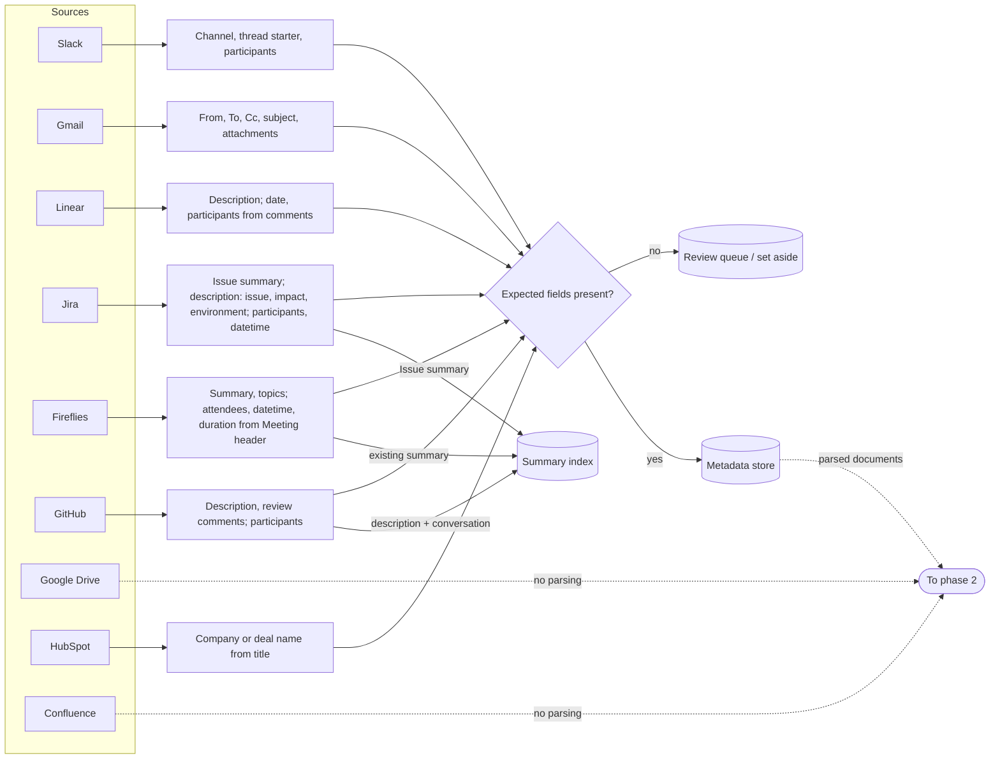
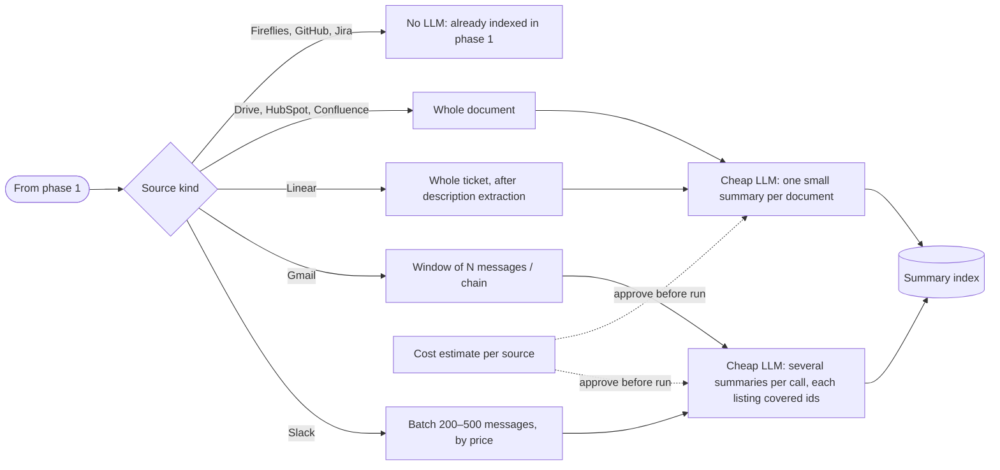

# 001 — Injection (ingestion) brainstorm

Status: draft. Sections 1–3 come from the dictated notes. Section 4 lists what a survey of the
data found (samples of 2–3K documents per source); none of it is decided yet.

## Principles

- Build processing pipelines per **type of data** rather than per source.
- First iteration is as cheap as possible; spend more only in later iterations.
- Sources are independent of each other, so they run in parallel.
- Estimate the cost before any paid LLM run.
- Every format needs everything it requires in the format itself. If an expected field is
  missing, flag the document and process it later; don't fail the run.
- Goal of the first iteration: search over general summaries rather than chunking every
  document into the database.

## 1. Parsing strategy

What we parse, and from where. Parsing is deterministic (no LLM). Every document also has a
`title` field in the dataset.

| Source | Content fields | Metadata | If missing |
|---|---|---|---|
| Slack | Channel and thread structure: each record is a separate thread under a single channel. People don't always follow this structure, so it has to be accounted for. | Channel, thread starter (first message of the thread), participants | Flag |
| Gmail | Email messages | From, To, Cc, subject, path to attachments if any | Flag and review afterwards |
| Linear | Description (main field; most documents have it). Comments stay in the document. | Date if provided, participants from comments | Flag |
| Google Drive | Nothing | Nothing (not parsable without an LLM) | — |
| HubSpot | Nothing | Company or deal name (the document title) | Flag |
| Fireflies | Existing summary, topics | Attendees, datetime from the `Meeting header`, duration | Flag and process later |
| GitHub | Description, review comments | Participants from comments | Save the document to process later as a different format |
| Jira | `Issue summary`; description, including issue, impact and environment | Participants from comments; datetime if present, to know roughly when it happened | Flag |
| Confluence | Nothing | Nothing | — |

## 2. Summary strategy

How each data type gets its text to embed.

| Source | Text to embed | LLM |
|---|---|---|
| Slack | LLM summaries over batches of 200–500 messages (size depends on the price). One summary can cover several threads and links back to the threads it covers. Input is the prompt plus the threads; output is small: summary plus the thread ids. | Cheap LLM |
| Gmail | Same idea as Slack: a window of N messages produces a summary that refers back to the messages. | Cheap LLM |
| Linear | One summary per ticket (documents average ~5K characters). | Cheap LLM |
| Google Drive | A small summary per document; expand later. | Cheap LLM |
| HubSpot | Summary per record. | Cheap LLM |
| Fireflies | The existing summary from parsing. | None |
| GitHub | The parsed description (main embedding point) plus the conversation. | None |
| Jira | The parsed `Issue summary` (present on ~91% of tickets), for now instead of an LLM summary of the whole ticket. | None |
| Confluence | Summary per page, to have an index. | Cheap LLM |

## 3. Flows

Two diagrams: phase 1 parses every source and extracts metadata (no LLM); phase 2 uses a cheap
LLM to write summaries where no usable text exists. In both, a missing expected field sends the
document to the **review queue** instead of failing the run, and every summary keeps the ids of
the source documents it came from.

### Phase 1: parsing and metadata extraction

Each source has its own deterministic parser. Fireflies, GitHub and Jira already carry text
worth embedding, so they reach the summary index in phase 1; everything else waits for phase 2.

### Phase 2: LLM usage tactic

A cheap LLM, run only after the cost estimate is approved. Conversations are batched so one
call covers many documents; tickets and long documents get one summary each.

## 4. Data findings

What the dataset actually provides, beyond or against sections 1–3. Shares are of sampled
documents. Nothing here is decided.

**Gmail: each document is already a whole thread.** Content is a list of 3–8 emails (median 5)
stored as text; ~95% parse as a list, the rest are plain text. `From` is on 98% of emails, but
`To`, `Date` and `Subject` are on only ~76% and `Cc` on ~61%, because later replies often drop
headers. Attachments are only **names** listed under `Attachments:` (or `Attachment`,
`Attachments referenced`, ...); the dataset has no attachment files or paths. `Date` per email
is available and missing from section 1. The thread itself may be the natural window.

**Slack:** participants are first names only (`maria`, `sam`). Only ~18% of threads mention
any date, so there is no reliable time metadata. Some titles are leaked file paths
(`slack/random/...json`) instead of channel names; these are the structure breaks to flag.

**Linear:** comments follow `YYYY-MM-DD - Name (Role): text`, giving date, participant and role
per comment. `acceptance_criteria` is on 75% of tickets; `comments` on 77%.

**Jira:** comments follow `Name (Role): text`, so roles come for free. Structured fields beyond
description: `Issue summary` (91%), `Impact` (55%), `Environment` (46%), `resolution` (62%),
`investigation_notes` (78%), `steps_to_reproduce` (43%), sometimes `root_cause` and `Status`.
`Issue summary` could serve as a free summary.

**GitHub:** review discussion comes in several formats: `review_comments` (52%),
`review_conversation` (15%), `review_thread` (8%), `conversation` (5%). Requiring
`review_comments` would set aside roughly half the PRs. `release_notes` (78%) is a short
built-in summary that section 1 doesn't use. Only ~23% mention a date.

**HubSpot: has parsable structure.** Title is the company or deal name (now in section 1),
and the content has keys `notes` (84%), `next_step` (72%), `blockers` (66%) and
`timeline` (49%); 99% mention dates. Records reference other sources by id (Jira tickets,
Fireflies meetings, Drive docs).

**Fireflies:** only ~67% use the single `Meeting header` line
(`Date; Start; Duration; Attendees`). The rest spread the same data over separate `Date`,
`Attendees` and `Duration` keys. Attendees include role and company, e.g. `Ethan Ross (CTO)`.
A summary exists in ~85% (`summary` or `Summary`), `action_items`/`next_steps` in ~39%,
topics in ~44%.

**Google Drive:** title is a descriptive file name; ~62% mention a date. Agrees with section 1:
no reliable structure.

**Confluence:** ~75% mention a date; a few pages carry `Owner`, `Revision history` or
`Change log`. ~20% have a `Summary` section that could replace the LLM summary.

## Open questions

- Which data types the per-type pipelines are organized around.
- Gmail windowing: one thread per document already, so batch threads like Slack, or summarize
  each thread on its own?
- Slack: how to handle threads that don't follow the channel/thread structure.
- Fireflies: whether action items need an LLM.
- Whether to use the other free summaries found in section 4 (GitHub `release_notes`,
  Confluence `Summary`) instead of LLM summaries. Jira already uses `Issue summary`.
- Jira: what to embed for the ~9% of tickets without an `Issue summary`.
- Cost estimate per source before running.
