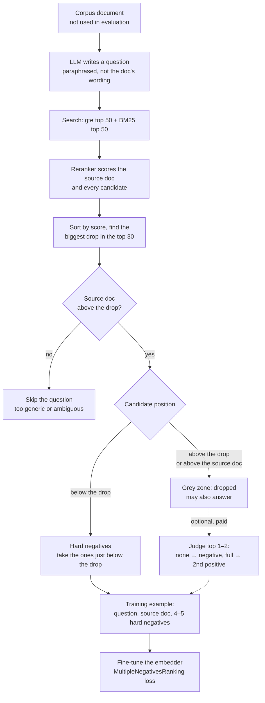

# Can a reranker threshold replace the judge? The grey zone

Status: findings and decision, 11 November 2026. Companion to brainstorm 003
(negative-sampled training set). Goal: avoid paying an LLM judge for every hard negative.

**Decision (the user, 11 November): use the per-question drop rule (Finding 3).** The fixed
0.02 cut (Finding 2) is kept for comparison.

## The question

When we mine hard negatives for a question, some candidates near the right document may
also answer it (**false negatives**). Training on them teaches the model to push away valid
answers. Brainstorm 003 proposed asking a judge about every candidate close to the right
document. That costs about $24 for 2,000 questions with Gemini. Can the reranker's scores do
the job instead?

## What the grey zone is

For a training question we know one right document (the positive). The reranker scores it
and every candidate from the search. Each candidate lands in one of two zones:

- **Grey zone:** candidates the reranker finds about as relevant as the right document, or
  more. Some are near-duplicates that also answer the question (false negatives), most don't
  (true hard negatives), and the score can't tell which (Finding 1).
- **Safe zone:** candidates clearly below. They are used as hard negatives without a judge.

Where the line between them sits is the whole question of this note. Two ways were tested:
a fixed margin below the right document (Finding 2) and the biggest drop in each question's
own scores (Finding 3, chosen).

- **Skip:** if the reranker prefers other documents over the one the question was written
  from, the question is ambiguous or badly generated.
- **Grey zone:** the cluster above the biggest drop. It may hold answers, and only reading
  tells, so it's dropped for free.
- **Hard negatives:** just below the drop. Still near-duplicates, but confidently not answers.
- **Judge:** optional, only if the hardest negatives turn out to matter (about $1 per 2,000
  questions with DeepSeek).

## Data used

- The 46 semantic failures of run 15, about 53 candidates each (gte top 50 + the right
  document + the documents the run showed).
- Reranker scores (gte-reranker-modernbert-base, full text, 0–1) for all of them.
- Gemini embedding scores for all of them (`exploration/gemini_embedding/`).
- Judge ratings (Gemini, full / partial / none) for 229 candidates that aren't the right
  document: the 5 documents the run showed for each failure, the hardest candidates.

"Gap" below means *candidate's score − right document's score* for the same question.

## Finding 1: inside the grey zone, no threshold separates them

| Judge says | n | Reranker gap, p10 to p90 | Gemini gap, p10 to p90 |
|---|---:|---|---|
| Fully answers (false negative) | 6 | −0.017 to +0.071 | −0.029 to +0.036 |
| Partly answers | 23 | −0.041 to +0.021 | −0.033 to +0.010 |
| Doesn't answer (true hard negative) | 200 | −0.051 to +0.053 | −0.067 to +0.026 |

The ranges overlap almost completely: for the reranker's probabilities, its raw logits and
Gemini. Near-duplicates differ in one detail, and only reading the document shows which.
**Inside the zone, only a judge can tell them apart.** A threshold can only decide *how big*
the zone is.

## Finding 2: a fixed cut (compared, not chosen)

> **Rule:** drop every candidate scoring above the right document or within 0.02 below it.

**How 0.02 was set:** by hand. The 6 false negatives sit at −0.018, −0.016, −0.008, +0.035,
+0.069 and +0.073; the lowest is −0.018, rounded down to −0.02. It isn't derived from a
false-negative rate, its safety margin is 0.002, and one more false negative at −0.025
would break it.

| Cut | Negatives left per question (median) | Fewest | Questions with < 5 |
|---|---:|---:|---:|
| below right document − 0.02 | 44 | 5 | 0 |
| below right document − 0.03 | 39 | 5 | 0 |
| below right document − 0.044 (NVIDIA's "95% of the positive") | 32 | 2 | 3 |

It catches all 6 false negatives but also throws away **145 of the 200** true hard negatives
(a median of 8 candidates per question).

## Finding 3: the biggest drop in each question's scores (chosen)

The user's idea: instead of one margin for every question, let each question pick its own
line where the reranker's scores fall off sharply.

**Is there a drop?** Yes. Sorting each question's candidates by reranker score, the biggest
step between neighbours in the top 30 is a median **6.4× bigger** than a typical step (at
least 4.7× for three quarters of the questions). In absolute terms it's small, median
0.014, but it stands out. Above it sits a small cluster: median **2.5** documents (a quarter
of questions have 1, a quarter 8 or more, at most 29).

> **Rule:**
> 1. Find the biggest drop in the top 30.
> 2. Drop everything above it, and everything scoring above the right document.
> 3. If the right document is below the drop, skip the whole question.
> 4. Take hard negatives from just below the drop.

| On the 229 judged candidates | Biggest drop | Fixed 0.02 cut |
|---|---:|---:|
| False negatives caught | 5 of 6 | 6 of 6 |
| True hard negatives thrown away | **93 of 200** | 145 of 200 |
| Candidates dropped per question (median) | **2.5** | 8 |

It catches nearly all false negatives while keeping about half again as many true hard
negatives (107 against 55). One false negative falls just below the drop.

**The right document is above the drop in only 27 of 46 failures.** In the other 19, the
reranker's confident cluster is other documents: near-duplicates that also answer, or
reranker mistakes. For synthetic training questions this gives step 3: if a question's own
source document lands below the drop, the question is ambiguous or the reranker disagrees
with it, so it's skipped. That filters bad questions for free.

## Caveat: not verified yet

Both rules rest on **6** false negatives from a **biased** sample. Only the top 5 candidates
of *failed* questions were ever rated, nothing lower in the list. A wrong answer also means
the shown documents mostly didn't answer, which pushes the false-negative count down. These
are benchmark questions; synthetic ones may behave differently.

**Check before trusting the rule:** judge about 300 candidates from just below the drop,
verdict only. About **$0.10 with DeepSeek** or $0.45 with Gemini. If almost none are
"full", the rule holds. The same check, spread over bands, also gives the false-negative
rate by distance from the right document.

## What the literature brings

No paper found uses exactly "the biggest reranker score drop per question" to pick
negatives. The rule combines three known ideas.

**1. Denoise hard negatives with a cross-encoder: RocketQA** (Qu et al., NAACL 2021,
[arXiv 2010.08191](https://arxiv.org/abs/2010.08191)).
- In MS MARCO, about 70% of the unlabelled top passages they checked were actually positives.
  The false-negative problem is real and big.
- They keep top-retrieved passages with cross-encoder score **< 0.1 as negatives** and use
  those **> 0.9 as extra positives**. A manual check found the selection more than 90%
  accurate.
- Denoising matters a lot. MS MARCO MRR@10: in-batch negatives 32.4; hard negatives
  *without* denoising **26.0** (worse than no hard negatives); *with* denoising **36.4**.
  NQ R@5: 68.0 → 73.2.
- **For us:** fixed absolute thresholds don't transfer. Our reranker's scores are squashed
  (half of all candidates fall between 0.77 and 0.86), which is why we need a relative or
  per-question line. Their "very high score → extra positive" idea maps onto our grey zone:
  a judged "full" can become a second positive instead of being dropped.

**2. Positive-aware filtering: drop what scores near or above the positive.**
- NV-Retriever ([arXiv 2407.15831](https://www.arxiv.org/pdf/2407.15831)): drop negatives
  above a share of the positive's score (e.g. 95%), then take the top-k. 50–57% fewer
  false negatives than a plain top-k. Built into sentence-transformers as
  `mine_hard_negatives(relative_margin=...)`
  ([docs](https://sbert.net/docs/package_reference/util/hard_negatives.html)) and used by
  NVIDIA's embedding recipe.
- Multi-level distillation ([arXiv 2312.16821](https://arxiv.org/pdf/2312.16821)): a
  candidate scoring **above the positive** is treated as a false negative. Same as our
  step 2.
- Multilingual retrieval ([arXiv 2509.09459](https://arxiv.org/pdf/2509.09459)): GPT-4o
  judges false negatives, and the best variant simply discards the top-10 ranked negatives.
  A fixed rank skip; our drop is an adaptive one.
- RRRA ([arXiv 2508.11670](https://arxiv.org/html/2508.11670)): negative distributions vary
  by query, so *uniform* filtering discards useful negatives or keeps harmful ones. This
  supports a per-question line over a fixed margin. They use a learned adapter instead of a
  gap rule.

**3. Find the natural cut in a ranked score curve: knee detection.**
- Tail-Aware Adaptive-k (Song et al., June 2026,
  [arXiv 2606.11907](https://arxiv.org/abs/2606.11907)): ranked similarity curves have a
  **steep–flat–steep** shape, a move from relevant to noise. They find the knee, then
  confirm the start of the noise tail with an extreme-value goodness-of-fit test in a
  window around it. Near-oracle context selection (F1 within 2–3% of oracle) on
  WebQuestions, 2WikiMultiHopQA and MuSiQue. It's used for choosing how many passages go
  to the LLM, not for negatives.
- Vectara's knee reranking
  ([docs](https://docs.vectara.com/docs/search-and-retrieval/rerankers/knee-reranking)):
  the same idea in production on reranker scores. It needs more than 4 results to find a
  knee.
- Learned truncation (BiCut, [arXiv 2102.12793](https://arxiv.org/pdf/2102.12793)) and
  older score-distribution methods decide where to stop reading a ranked list.
- **For us:** "biggest gap in the top 30" is the crudest knee detector. A proper one
  (Kneedle, or TAA-k's knee + tail test) could be steadier, especially for the questions
  where the biggest gap sits at rank 1 or deep at 20–29.

**4. Which negatives to take below the line: SimANS** (Zhou et al., EMNLP 2022,
[arXiv 2210.11773](https://arxiv.org/pdf/2210.11773)).
- Negatives ranked *around* the positive are more informative and less likely to be false
  negatives than the very top ones. They sample with a probability peaked near the
  positive's score instead of always taking the hardest.
- **For us:** below the drop, sample negatives weighted toward the ones closest to it,
  instead of a fixed top-k. That keeps some variety and lowers the cost of the odd false
  negative that slips under the line.

Background: [Negative sampling in IR, a survey (arXiv 2603.18005)](https://arxiv.org/pdf/2603.18005)
and [dense retrieval survey (arXiv 2211.14876)](https://arxiv.org/pdf/2211.14876).

## What it does to the cost (2,000 questions)

| | Judge everything in the grey zone (003) | Drop rule (this note) |
|---|---:|---:|
| Generate questions | ~$1 | ~$1 |
| Judging | ~$24 (Gemini) | **$0** (+ ~$0.10–0.45 once, for the check) |
| Training (Vast.ai) | ~$0.50 | ~$0.50 |
| **Total** | **~$25** | **~$2** |

Optional later: if the hardest negatives turn out to matter, judge only the top 1–2
grey-zone candidates per question with a verdict-only DeepSeek prompt (about 4k ratings,
about $1). A "full" verdict can become a second positive (RocketQA's idea).

## Where the per-rating cost came from

$0.0024 per rating is our current document judge on Gemini 3.8 Flash:
- about 2,000 input tokens (document + question + instructions) × $0.75 per million;
- plus about 250 output tokens (reasoning, answer, quote) × $3.75 per million.

A verdict-only output and a cheaper model (DeepSeek off-peak) bring it to about $0.0003.

## Open points

- Run the ~$0.10 check below the drop.
- Biggest gap vs a proper knee detector (Kneedle, TAA-k): which is steadier per question?
- Below the drop: fixed top-k or SimANS-style sampling?
- How often synthetic questions get skipped by step 3 (their own source below the drop).
